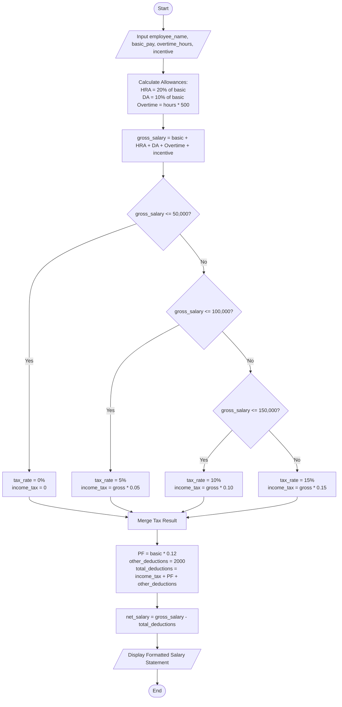
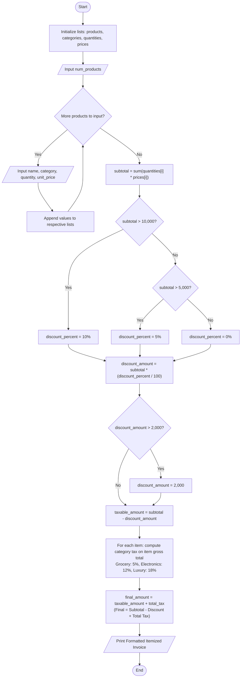
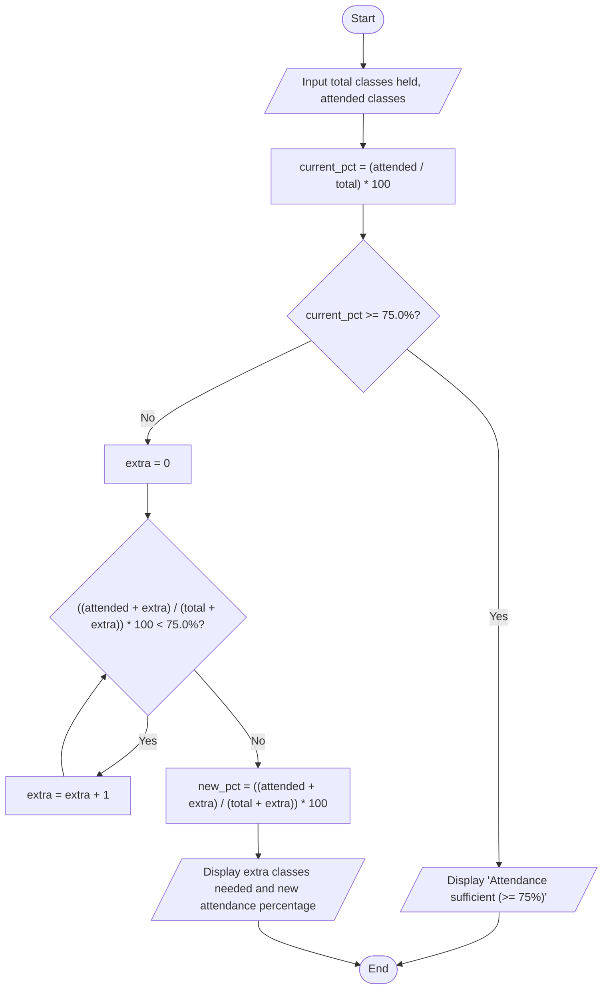
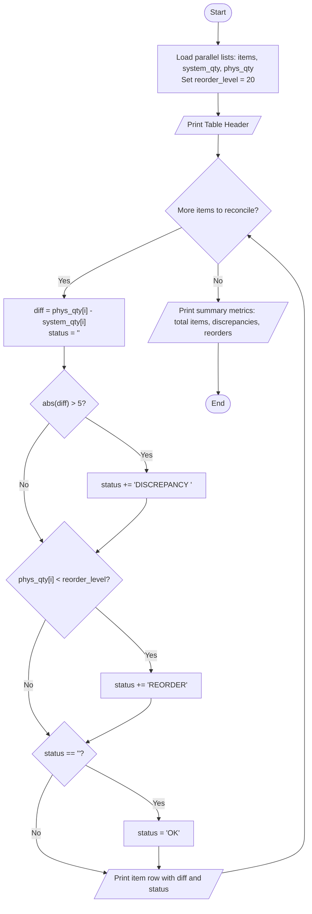
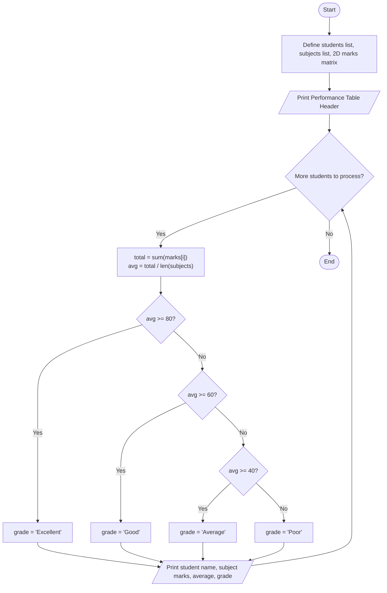
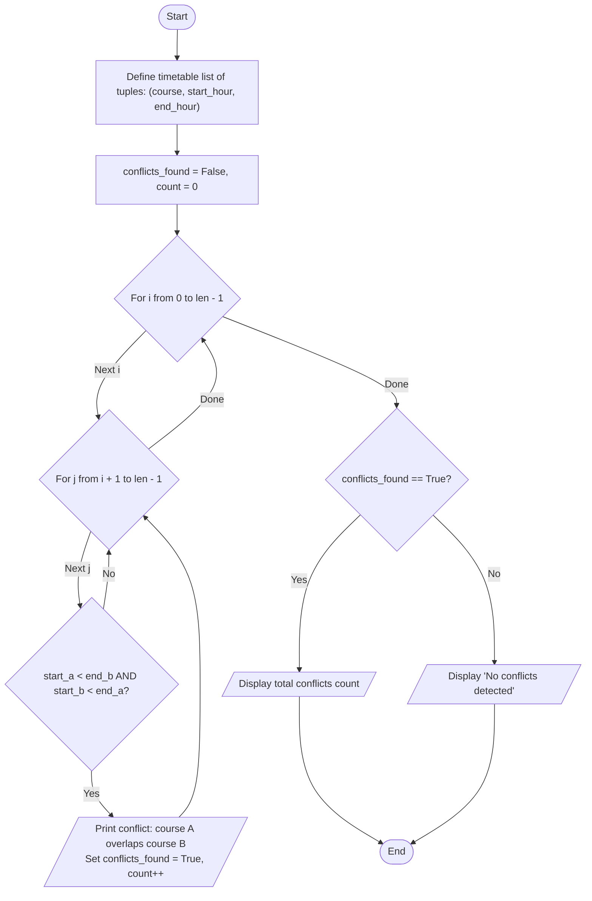
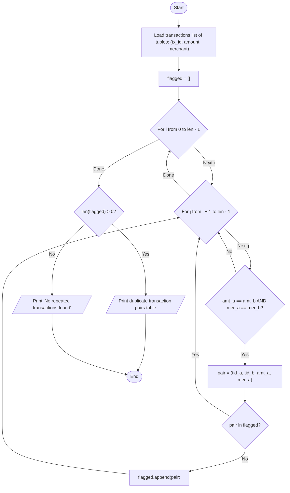
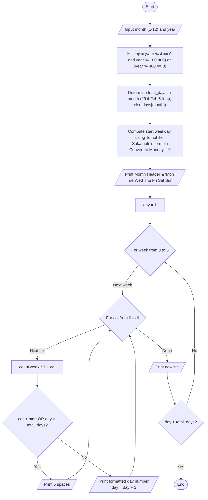
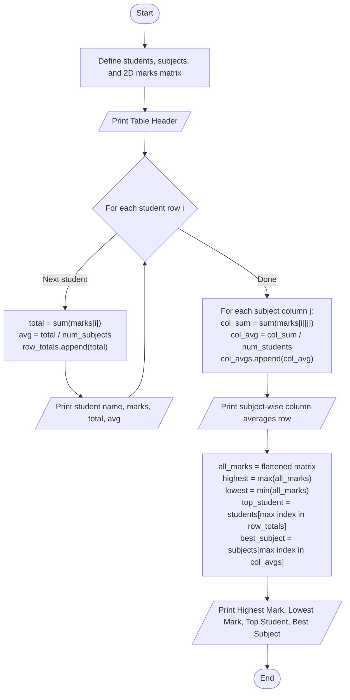
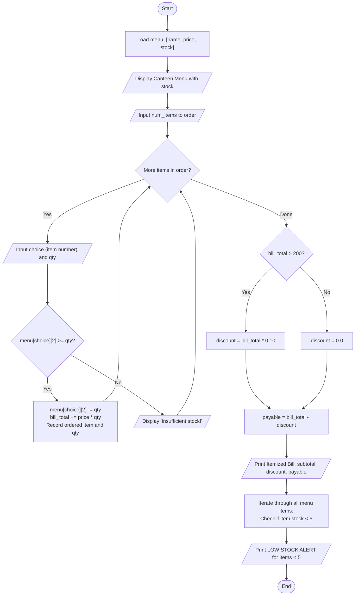

# Program Flowcharts

This document provides visual flowcharts for all 10 case studies in the **Python Activity-Based Learning** project using GitHub-compatible Mermaid diagrams.

---

## Case Study 1: Employee Payroll and Deduction Analysis

---

## Case Study 2: Retail Billing with Multiple Discount Rules

---

## Case Study 3: Attendance Recovery Computation

---

## Case Study 4: Warehouse Inventory Reconciliation

---

## Case Study 5: Student Performance Trend Analysis

---

## Case Study 6: Student Timetable Conflict Detection

---

## Case Study 7: Repeated Transaction Detection

---

## Case Study 8: Nested Loop Calendar Generator

---

## Case Study 9: Student Marks Matrix Analysis

---

## Case Study 10: Smart Canteen Order and Stock Management

